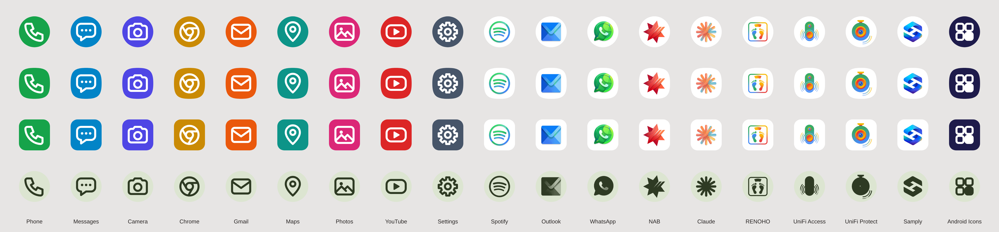

# Android Icons

A small icon pack app for [Lawnchair](https://lawnchair.app) (it also works in Nova and most other launchers that support icon packs).



Rows show how the icons look with circle, squircle and rounded-square icon shapes, plus Android 13+ themed icons. The icons are adaptive, so Lawnchair masks them to whatever icon shape you've chosen.

## Install

1. Open the [latest release](https://github.com/philiplarosa/Android-Icons/releases/latest) on your phone and tap **AndroidIcons.apk**.
2. Allow your browser to install unknown apps when Android asks, then tap **Install**.

Every push to this repo builds a new release. Newer builds install over older ones; you don't need to uninstall first.

## Use it in Lawnchair

- **Whole pack:** Lawnchair Settings › General › Icon pack › Android Icons. Apps listed in `appfilter.xml` switch automatically. Everything else keeps its normal icon.
- **One app at a time:** long-press an app, tap the edit (pencil) option, tap the icon, choose Android Icons and pick any icon.

Open the Android Icons app to see which icons match an app on your phone (✓ means it auto-applies).

## Included icons

Phone, Messages, Camera, Chrome, Claude, Gmail, Outlook, Maps, NAB, Photos, RENOHO Health, Samply, YouTube, Settings, Spotify, UniFi Access, UniFi Protect, WhatsApp.

Spotify, Outlook, WhatsApp, NAB, Claude, RENOHO Health, Samply, UniFi Access and UniFi Protect come from artwork in `art/`. RENOHO Health, Samply and UniFi Access aren't in `appfilter.xml` yet (their component names aren't known), so pick them manually in Lawnchair for now. The rest are vector glyphs.

`appfilter.xml` covers the Google, Samsung and stock Android versions of Phone, Messages and Camera. If an icon shows "No matching app found" in the app, your phone uses a different component name. You can still pick that icon manually, or add the right line (see below).

## Add or change an icon

All of it lives in `app/src/main/res/`:

| File | What it does |
| --- | --- |
| `drawable/<name>.xml` | The icon: a background colour plus a foreground glyph |
| `drawable/<name>_glyph.xml` | The white glyph (vector, drawn on a 24×24 grid) |
| `xml/drawable.xml` | Icons Lawnchair shows in its picker |
| `xml/appfilter.xml` | Which app each icon applies to automatically |

**To add an icon:**

1. Copy an existing pair, for example `youtube.xml` and `youtube_glyph.xml`, and rename both (lowercase letters, numbers and underscores only).
2. Change the background colour in `<name>.xml`. For the glyph, either edit the path, or in Android Studio use File › New › Vector Asset to import an SVG and point the icon's `foreground` at it.
3. Add `<item drawable="<name>" name="Label" />` to `xml/drawable.xml`.
4. In the Android Icons app, scroll to **Installed apps** and tap the app you want. That copies its `appfilter.xml` line. Paste it into `xml/appfilter.xml` and set `drawable` to your icon's name.

**From artwork (PNG or JPG):** put the image in `art/`, add a line for it to `tools/import_all.sh` and run that script (needs Python with Pillow: `pip install pillow`). It centres and sizes the artwork, uses the image's background colour as the icon background, and makes the themed-icon version. Then do steps 3 and 4. Art on a plain background with some empty space around it works best. Change `--size` on that line if an icon looks too big or too small next to the others. For stars and other pointy shapes, add `--center circle` so the points sit evenly around the middle. If art looks too wide, add `--height 1.1` to make it taller. If it looks off-centre, nudge it with `--shift X Y` (units; positive moves right and down).

You can do all of this in the GitHub web editor from your phone, including artwork: GitHub runs `tools/import_all.sh` before every build, so you only need to upload the image and edit the text files. Commit, wait for the build to finish (about 3 minutes), then install the new release.

## Build locally

Needs JDK 17+ and the Android SDK (Android Studio installs both).

```sh
./gradlew assembleRelease
# APK: app/build/outputs/apk/release/app-release.apk
```

Every build is signed with `app/sideload.keystore`. The password is `android`, so builds from your computer and from GitHub can update each other. That's fine for sideloading but not secure: use your own private key if you ever publish this to the Play Store.
